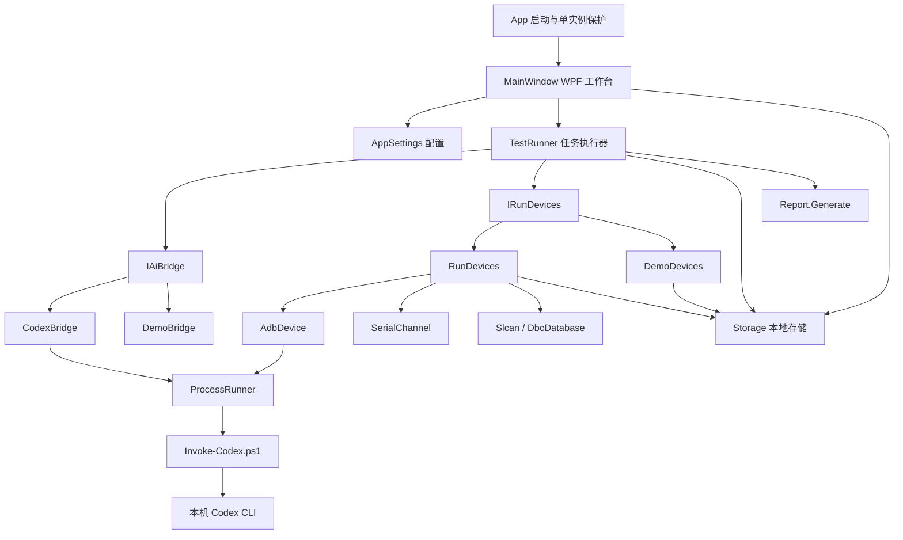
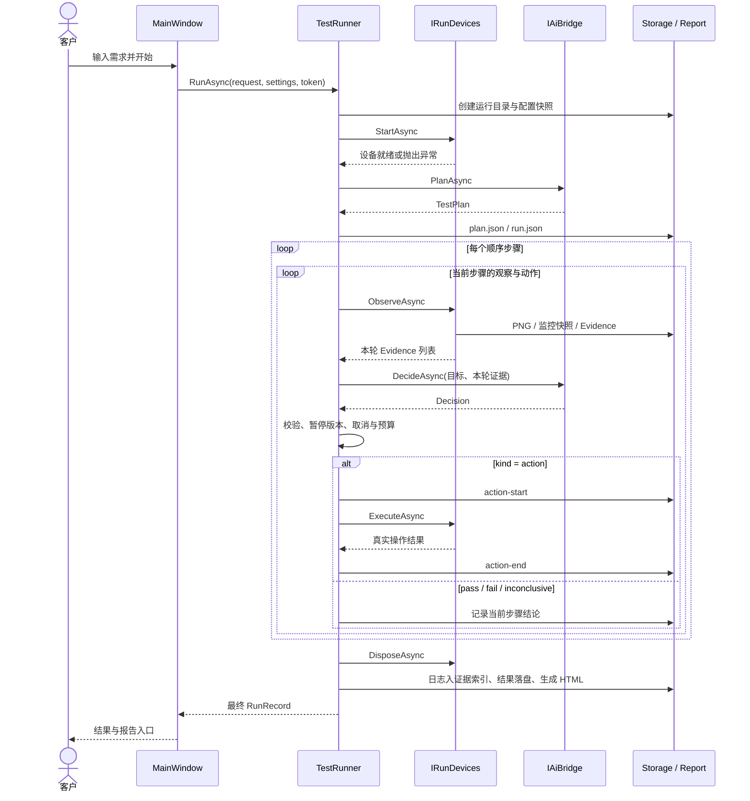
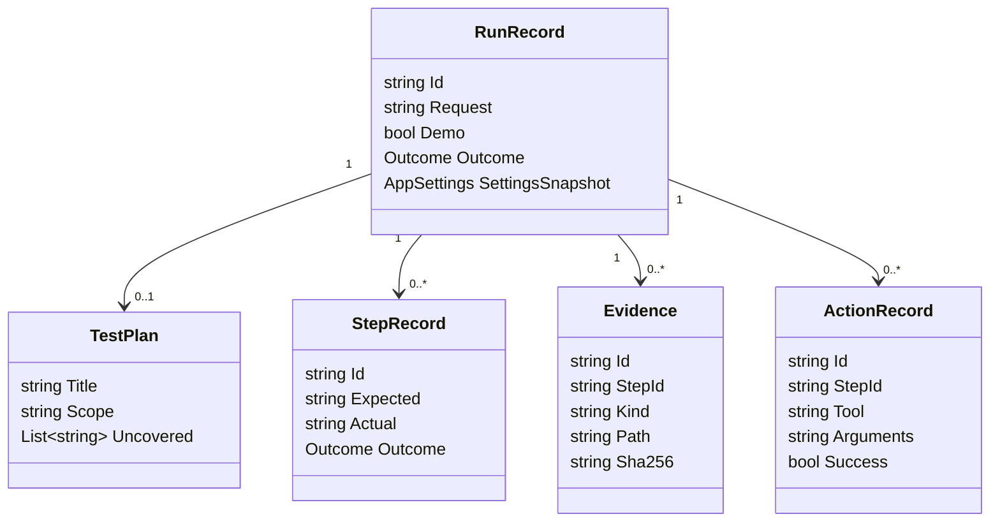

# AIclient 本地版软件架构与实现说明

版本：v0.2 · 整理日期：2026-10-25 · 对应当前 `AIclient` 源码

2026-10-25 新增测试 Skills、自动经验积累、折叠设备配置、VISA 与旧总线库兼容进程。新增部分及其对初版架构的变更详见第 21 节；早期章节未逐项重复列出的新增字段以第 21 节和源码为准。当前软件检查为 47 项。

下次续接先读 [PROJECT_CONTEXT.md](PROJECT_CONTEXT.md)。最新约定：ADB1 / ADB2 为中性编号，允许两台都是手机；当前软件检查为 32 项通过，详细状态见 [VALIDATION.md](VALIDATION.md)。

本文面向项目负责人、后续开发人员及台架集成人员，说明目前软件实际如何工作、数据保存在哪里、设备如何接入，以及下一步可以从哪里扩展。

本文以当前代码为准。[DESIGN.md](DESIGN.md) 记录需求和设计方向；[README.md](README.md) 负责启动和基本使用；[VALIDATION.md](VALIDATION.md) 记录已经完成的验证。本文件描述实现现状，不将规划中的功能视为已完成。

## 阅读目录

1. [系统定位与当前范围](#1-系统定位与当前范围)
2. [技术组成与项目结构](#2-技术组成与项目结构)
3. [总体架构与职责边界](#3-总体架构与职责边界)
4. [应用启动与界面组织](#4-应用启动与界面组织)
5. [一次测试任务的完整执行过程](#5-一次测试任务的完整执行过程)
6. [AI 接口与本地 Codex 调用](#6-ai-接口与本地-codex-调用)
7. [设备执行接口与工具协议](#7-设备执行接口与工具协议)
8. [ADB 双设备实现](#8-adb-双设备实现)
9. [串口采集与命令执行](#9-串口采集与命令执行)
10. [SLCAN 总线与 DBC 分析](#10-slcan-总线与-dbc-分析)
11. [串口电源实现](#11-串口电源实现)
12. [配置模型与完整示例](#12-配置模型与完整示例)
13. [运行数据模型](#13-运行数据模型)
14. [证据、文件存储与报告](#14-证据文件存储与报告)
15. [暂停、停止、超时与异常恢复](#15-暂停停止超时与异常恢复)
16. [线程、进程与性能特征](#16-线程进程与性能特征)
17. [演示模式与验证体系](#17-演示模式与验证体系)
18. [构建、运行与部署](#18-构建运行与部署)
19. [现有实现边界与后续扩展](#19-现有实现边界与后续扩展)
20. [开发维护与故障定位](#20-开发维护与故障定位)

## 1. 系统定位与当前范围

### 1.1 面向的业务

客户输入自然语言，例如：

> 帮我测试下车机蓝牙功能是否正常，验证与手机的配对、连接、断开和重连。

AIclient 将任务转换为一组可检查的目标，然后循环完成以下过程：

```text
采集当前截图和设备数据
        ↓
将本轮证据交给 Codex 分析
        ↓
获得一个动作建议，或一个功能结论
        ↓
客户端验证并执行允许的设备动作
        ↓
重新采集，确认实际效果
```

最终输出本地运行记录、逐轮截图、串口/总线数据、AI 输入输出和 HTML 报告。

### 1.2 当前交付形态

当前是一个 Windows 本地桌面程序。没有 Web 后端、HTTP 业务服务、数据库、云任务调度器、账号中心或报告上传模块。

“本地运行”指客户端、设备控制和文件管理在本机完成。Codex CLI 的模型推理仍通过其配置的服务完成，需要相应网络和账号权益；这不是本地离线大模型。

| 能力 | 当前实现 |
| --- | --- |
| 自然语言拆解 | 本机 Codex CLI 生成结构化计划 |
| 图片判断 | 将本轮 PNG 附件交给 Codex |
| 执行模式 | 真实设备 / 演示模拟二选一 |
| 设备编号 | 两个中性 ADB 槽位：`adb1`、`adb2`，不限定车机/手机类型 |
| 串口 | 多个配置通道，Windows 原生收发与持续接收 |
| 总线 | 一个 SLCAN classic CAN 通道，基本 DBC 标量解析 |
| 电源 | 一个逻辑电源，复用已启用串口通道发送配置命令 |
| 任务调度 | 单窗口内一次运行一个任务，步骤顺序执行 |
| 数据持久化 | 本地 JSON、JSONL、PNG、TXT、DBC |
| 报告 | 静态本地 HTML，浏览器直接打开 |

### 1.3 与原 AT 客户端的关系

原工程为根目录的 `AT_Web_Client`、`AT_Web_Client.Kernel`、`AT_Core` 和各个 `Addins`。AIclient 参考其设备划分和报告层次，但当前没有引用原客户端的程序集，也没有把原插件框架加载进来。

原工程主要为 .NET Framework 4.7.2；AIclient 为 .NET 9 WPF。当前 ADB、串口、SLCAN 和电源路径均在 AIclient 内独立实现。后续复用专有驱动时，需要核对运行时、位数、初始化依赖和厂商 SDK，而不是直接假定旧 DLL 可以通用加载。

## 2. 技术组成与项目结构

### 2.1 技术组成

| 项目 | 当前技术 | 用途 |
| --- | --- | --- |
| 应用语言 | C# | UI 事件、执行器、设备和存储 |
| 运行目标 | `net9.0-windows` | Windows 桌面运行时 |
| UI | WPF / XAML | 主工作台、配置、运行记录 |
| JSON | `System.Text.Json` | DTO 序列化、反序列化、结果解析 |
| 外部进程 | `System.Diagnostics.Process` | PowerShell、Codex、ADB |
| 串口 | Win32 `kernel32.dll` P/Invoke | 不依赖额外串口 NuGet 包 |
| 截图 | ADB `screencap` + WPF PNG 解码 | 图像采集与显示 |
| 完整性摘要 | SHA-256 | 证据文件哈希 |
| 任务取消 | `CancellationToken` | 停止、进程超时、总时长预算 |
| 模块替换 | 构造函数传入接口 | 切换真实设备、演示和检查替身 |

当前没有独立 DI 容器，没有第三方 MVVM 框架，也没有严格拆分为多个业务程序集。生产应用为一个 WPF 工程；检查程序为另一个控制台工程。

### 2.2 源码结构

```text
AIclient/
├─ AIclient.sln
├─ DESIGN.md                      需求与设计方向
├─ ARCHITECTURE.md                当前实现架构（本文）
├─ README.md                      使用与构建说明
├─ VALIDATION.md                  验证状态
├─ Start-AIclient.cmd             双击启动入口
├─ Start-AIclient.ps1             必要时构建后启动
├─ scripts/
│  ├─ Invoke-Codex.ps1            固定 Codex 调用桥
│  └─ Test-LocalCodex.ps1          真实图片连通性检查
├─ src/AIclient/
│  ├─ AIclient.csproj
│  ├─ App.xaml                    公共样式资源
│  ├─ App.xaml.cs                 启动、数据目录、单实例保护
│  ├─ MainWindow.xaml             三个页面与工作台布局
│  ├─ MainWindow.xaml.cs          界面事件与模块组装
│  ├─ Models/Domain.cs            全部主要 DTO 与参数校验
│  ├─ Services/
│  │  ├─ TestRunner.cs            测试编排与结果汇总
│  │  ├─ CodexBridge.cs           IAiBridge、提示词、Schema
│  │  ├─ ProcessRunner.cs         子进程与取消/超时
│  │  ├─ RunDevices.cs            IRunDevices、工具路由与采集
│  │  ├─ AdbDevice.cs             ADB 进程封装
│  │  ├─ SerialChannel.cs         Windows 串口底层
│  │  ├─ CanProtocol.cs           SLCAN 与基本 DBC
│  │  ├─ Storage.cs               Storage 与 Report
│  │  └─ Demo.cs                  演示 AI 与演示设备
│  ├─ GlobalUsings.cs
│  └─ app.manifest
├─ tests/AIclient.Checks/
│  ├─ AIclient.Checks.csproj
│  └─ Program.cs                  自包含检查程序
├─ data/                          默认实际运行数据，不入版本控制
└─ artifacts/                     检查与截图产物，不入版本控制
```

## 3. 总体架构与职责边界

### 3.1 模块依赖图



### 3.2 各层职责

| 模块 | 负责 | 不负责 |
| --- | --- | --- |
| `MainWindow` | 读取输入、组装实现、刷新 UI、打开报告 | 不直接解释 AI 动作并操作硬件 |
| `TestRunner` | 任务生命周期、步骤循环、预算、结论校验、收尾 | 不实现具体 ADB/串口协议 |
| `CodexBridge` | 构建上下文、调用 CLI、解析结构化返回 | 不直接调用设备工具 |
| `RunDevices` | 设备初始化、证据采集、动作分发、设备参数检查 | 不生成自然语言计划 |
| `AdbDevice` | 精确 serial 路由、ADB 命令、截图 | 不判断蓝牙功能是否通过 |
| `SerialChannel` | COM 口读写与故障通知 | 不理解串口数据业务含义 |
| `Slcan` / `DbcDatabase` | 数据帧格式与标量信号解码 | 不解释复杂车辆业务规则 |
| `Storage` | 配置、运行记录、证据索引、历史和中断恢复 | 不提供数据库事务和远程同步 |
| `Report` | 将现有记录渲染为静态 HTML | 不生成新的测试事实 |

### 3.3 AI 与客户端的分工

Codex 负责“目标是什么、画面是什么、下一步建议什么、证据是否支持结论”。客户端负责“实际操作哪个设备、参数是否合法、动作何时执行、结果如何留存”。

例如 Codex 可以建议 `adb.tap`，但不能由返回内容指定任意 Shell 命令。客户端只有固定工具分支，没有“执行模型输出 PowerShell”这一接口。

这个边界包括提示词约定和程序校验两部分：固定工具路由由程序约束；要求 Codex 不使用其自身工具目前主要通过提示词表达。`--sandbox read-only` 约束的是 CLI 进程环境，不能等同于已经完整禁用了用户 Codex 配置中的所有外部集成。

## 4. 应用启动与界面组织

### 4.1 启动链路

```text
Start-AIclient.cmd
  → powershell.exe -NoProfile -File Start-AIclient.ps1
  → 如果 Release EXE 不存在，先 dotnet build
  → AIclient.exe
  → App.OnStartup
  → MainWindow
```

启动脚本默认复用已有 Release 结果；修改源码后应使用 `Start-AIclient.ps1 -Build` 或手动构建，避免仍然运行旧 EXE。

### 4.2 数据目录选择

`App.FindRoot()` 按以下优先级决定数据根目录：

1. 环境变量 `AICLIENT_DATA_ROOT`，若设置则转为绝对路径。
2. 从 EXE 所在目录逐级向上寻找 `DESIGN.md`，使用该目录下的 `data`。
3. 如果找不到，使用 EXE 所在目录下的 `data`。

因此源码目录布局下通常落到 `AIclient/data`。拷贝程序到另一台机器时，数据位置取决于上述规则和目录写权限。

### 4.3 单实例保护

启动时对标准化后的数据根路径计算 SHA-256，截取部分作为 Windows 命名 Mutex 标识。同一 Windows 会话中，同一个数据根目录只允许一个应用实例。

这用于防止同一套记录被两个窗口并发写入。不同数据目录可以运行不同实例；当前没有跨目录的 ADB 设备租约服务，也没有全系统台架资源调度。

### 4.4 主窗口三个页面

| 页面 | 控件与行为 |
| --- | --- |
| 测试工作台 | 自然语言输入、演示开关、开始/暂停/停止、步骤列表、运行日志、双端截图、报告和证据目录按钮 |
| 设备与设置 | CLI/PowerShell/ADB 路径、模型、两端 serial、扫描与绑定、登录检查、项目背景、高级 JSON 编辑器 |
| 本地运行记录 | 最近 100 条可读取记录，查看报告和证据目录 |

运行中禁止修改工作台任务输入、模式和设备配置；`busy` 标志阻止同窗口重复启动任务。

### 4.5 配置编辑行为

“保存基础设置”读取表单基础字段，保留当前已应用的高级配置。“应用 JSON 设置”解析整份 JSON，校验后写盘并同步基础表单。

JSON 编辑器尚未点击应用的内容不会成为本次运行配置。“载入设备配置示例”只更新编辑器；示例通道默认关闭，仍需修改实际参数并应用。

## 5. 一次测试任务的完整执行过程

### 5.1 界面组装依赖

`MainWindow.RunTaskAsync()` 读取并保存配置，创建取消源，然后按模式组装：

| 模式 | AI 实现 | 设备实现 |
| --- | --- | --- |
| 真实模式 | `CodexBridge` | `RunDevices` |
| 演示模式 | `DemoBridge` | `DemoDevices` |

两种组合都交给同一个 `TestRunner`，共享步骤状态、持久化、取消和报告流程。

### 5.2 正常执行时序



### 5.3 创建运行记录

`Storage.CreateRun()` 创建唯一 ID，形如 `20261024_155059_d61867`，并建立 `screenshots` 和 `logs` 目录。配置通过 JSON 序列化再反序列化得到独立快照，避免后续界面变更改写历史台架配置。

此时运行状态已经是 `Running`。预检失败也能够留下运行记录，而不是只出现一条界面错误。

### 5.4 预检与计划

真实设备层先检查配置和已绑定 ADB 设备，保存 Android build fingerprint，打开启用的串口和总线，再交给 AI 规划。

计划由若干“测试目标”组成，例如“验证双方配对成功”，不是提前写死的一组点击坐标。提示词建议 1–12 步；程序和 Schema 实际允许 1–30 步。

当前计划生成并校验成功后自动执行，没有额外人工计划确认页，也没有运行前的计划编辑器。

### 5.5 单步骤闭环

每次循环先采集，再调用 AI，返回一个 `Decision`。如果建议动作，先写入动作开始记录，再执行一次工具，写入结束结果，随后进入下一轮重新观察。

如果返回结论，则结束当前步骤：

- `pass` → `Passed`。
- `fail` → `Failed`。
- `inconclusive` → `Inconclusive`。

只有当前步骤 `Passed` 才继续后续步骤；任何非通过结论都会停止后续依赖步骤。当前没有分支图、并行步骤、独立失败后继续或复杂清理节点。

### 5.6 当前没有自动重试

现有实现不会自动重试失败的 CLI 调用、无效 JSON、设备异常或发送失败。它们进入异常收尾并输出 `Error`。

AI 在一次未结束的目标中可以根据新截图继续探索，但这不等同于程序自动重试。人工重新运行会产生新的 runId，旧任务记录保留。

## 6. AI 接口与本地 Codex 调用

### 6.1 IAiBridge 契约

定义位于 [CodexBridge.cs](src/AIclient/Services/CodexBridge.cs)：

```csharp
public interface IAiBridge
{
    Task<TestPlan> PlanAsync(RunRecord run, CancellationToken token);
    Task<Decision> DecideAsync(
        RunRecord run,
        StepRecord step,
        IReadOnlyList<Evidence> observations,
        CancellationToken token);
}
```

新增其他模型调用方式时，可实现此接口，再修改主窗口的组装分支；不必修改设备协议或报告模型。

### 6.2 规划阶段输入

`PlanAsync()` 将以下内容写入提示词：

- 原始需求 `request`。
- 项目背景 `projectContext`。
- 配置中的 ADB 角色和 serial。
- 可用能力描述：串口通道、总线类型、DBC 信号、电源是否启用等。
- 已配置的设备命令别名。

规划阶段不附带当前截图。第一轮实际截图发生在计划生成之后的步骤执行中。

### 6.3 执行判断阶段输入

`DecideAsync()` 发送：完整计划、当前步骤 ID/标题/预期、项目背景、能力、命令别名、本轮证据元数据，以及当前步骤最近 12 个动作记录。

PNG 通过 CLI 图片参数单独附带；证据元数据标明角色、serial、原始宽高、记录时间和 evidenceId。串口/总线内容来自监控证据的 `summary`。

当前没有 CLI 会话续接。每次调用都是独立 `exec`，由客户端显式重建上下文；不调用 `resume --last`。上下文中的最近动作只取当前步骤，不自动附带所有前序步骤的实际结论。

### 6.4 本地调用进程链

```text
CodexBridge
  → ProcessRunner
  → powershell.exe -NoLogo -NoProfile -NonInteractive
      -File scripts/Invoke-Codex.ps1 -RequestPath <request.json>
  → 脚本读取清单与 prompt.txt
  → prompt 通过 stdin 传入 codex exec
  → response.json + stdout.jsonl + stderr.txt
```

当前实际命令形态为：

```text
codex --ask-for-approval never exec
  --cd <本次运行目录>
  --sandbox read-only
  --skip-git-repo-check
  --color never
  --json
  --output-schema <Schema文件>
  --output-last-message <最终结果文件>
  [--model <配置的模型>]
  [--image <图片1> ...]
  -
```

PowerShell 脚本使用参数数组调用 CLI。需求文本不会拼接到 PowerShell 源码，也没有使用 `Invoke-Expression`。

模型留空时继承本机 Codex 配置；登录环境沿用当前用户，不复制认证文件，不将 `CODEX_HOME` 改成运行目录。已有验证记录显示本机使用 ChatGPT 登录；这不构成对其他机器或未来账号额度的保证。

### 6.5 计划 JSON

```json
{
  "title": "车机与手机蓝牙基础联调",
  "scope": "基础配对、连接、断开与重连",
  "uncovered": ["未配置音频采集，不能验证实际媒体声音"],
  "steps": [
    {
      "id": "S01",
      "title": "进入双方蓝牙设置",
      "expected": "双方蓝牙设置页面可访问，且开关处于开启状态"
    }
  ]
}
```

本地 `TestPlan.Validate()` 检查标题、步骤数量、非空 ID/标题/预期和 ID 唯一性。它不独立判断测试范围是否足够完整，也不计算蓝牙功能覆盖率。

### 6.6 动作及结论 JSON

动作示例，证据 ID 应替换为本轮实际存在的值：

```json
{
  "kind": "action",
  "observation": "当前车机处于设置页，需要进入蓝牙设置。",
  "tool": "adb.key",
  "role": "adb1",
  "arguments": "{\"key\":\"BLUETOOTH_SETTINGS\"}",
  "evidenceIds": ["E00003"]
}
```

通过示例：

```json
{
  "kind": "pass",
  "observation": "本轮车机和手机截图均显示目标设备已连接，满足本步骤连接状态预期。",
  "tool": "",
  "role": "",
  "arguments": "{}",
  "evidenceIds": ["E00007", "E00008"]
}
```

`arguments` 当前是“包含 JSON 对象文本的字符串”，不是直接嵌入的对象。设备层执行时再解析它。新增客户端或工具时需要保持这一约定，或显式进行协议版本升级。

### 6.7 返回结果校验层次

| 层次 | 当前检查 |
| --- | --- |
| CLI | 通过 `--output-schema` 请求固定 JSON 形状 |
| Bridge | 进程退出码、结果文件存在、反序列化 |
| Runner | kind 合法、观察非空、证据属于本轮、pass/fail 至少引用一个证据、结论不携带动作、参数可解析为对象 |
| 设备层 | 固定工具名、实际角色、坐标范围、参数类型、命令别名、电压范围等 |

当前没有另一个完整 JSON Schema 验证器在本地重复检查所有额外字段，也没有为每个工具提供独立参数 Schema。缺失字段或错误类型会在 DTO/参数解析或执行检查时成为异常。

证据 ID 存在只说明结论可追溯，不代表程序已经独立确认 AI 的语义判断正确。当前没有置信度阈值、第二模型复核或通用图像断言引擎。

## 7. 设备执行接口与工具协议

### 7.1 IRunDevices 契约

定义位于 [RunDevices.cs](src/AIclient/Services/RunDevices.cs)：

```csharp
public interface IRunDevices : IAsyncDisposable
{
    Task StartAsync(RunRecord run, CancellationToken token);
    Task<IReadOnlyList<Evidence>> ObserveAsync(
        RunRecord run, StepRecord step, CancellationToken token);
    Task<string> ExecuteAsync(
        RunRecord run, StepRecord step,
        Decision decision, CancellationToken token);
}
```

`StartAsync` 管初始化，`ObserveAsync` 管本轮取证，`ExecuteAsync` 管一个动作，`DisposeAsync` 管本任务设备资源收尾。

### 7.2 完整工具表

以下参数对象在协议中均需编码进 `arguments` 字符串。

| 工具 | role | 参数 | 当前限制/返回含义 |
| --- | --- | --- | --- |
| `adb.capture` | 已绑定角色 | `{}` | 当前实现不立即单独截图，下一轮统一 Observe 重新采集 |
| `adb.tap` | 已绑定角色 | `x, y` | 坐标必须在该角色最近原图范围内 |
| `adb.swipe` | 已绑定角色 | `x1, y1, x2, y2, durationMs` | 端点范围校验；50–5000ms |
| `adb.key` | 已绑定角色 | `key` | 固定按键/设置入口枚举，见第 8 节 |
| `adb.text` | 已绑定角色 | `text` | 1–200 字符，限定 ASCII 集合 |
| `serial.send` | 空字符串 | `alias` | 引用已配置且 transport=serial 的命令 |
| `serial.expect` | 空字符串 | `channel, pattern, timeoutMs` | 本步骤 RX 字面关键字；100–30000ms |
| `bus.send` | 空字符串 | `alias` | 引用已配置且 transport=bus 的 SLCAN 数据帧 |
| `bus.expect` | 空字符串 | `signal, expected, tolerance, timeoutMs` | 唯一 DBC 信号；本步骤期间数据；100–30000ms |
| `power.output` | 空字符串 | `on` | 布尔值；电源已启用且串口存在 |
| `power.voltage` | 空字符串 | `volts` | 有限数值；在配置范围内；模板必须含 `{value}` |
| `wait` | 空字符串 | `durationMs` | 100–30000ms；后台采集继续 |

### 7.3 动作成功与功能通过

`ActionRecord.Success` 表示设备工具执行返回成功。例如 ADB 返回码为 0，或者串口字节已完整写出。

`StepRecord.Outcome=Passed` 表示 AI 根据新证据认定该步骤预期成立。二者分开记录：点击成功不直接将步骤设为通过；发送电源命令也不直接证明实际电压正常。

### 7.4 设备故障处理

后台串口错误和 SLCAN 错误应答进入 `faults` 队列。设备层在观察、执行和等待时检查队列，发现故障即抛出异常，任务停止。当前没有自动清除故障后继续或后台自动重连。

## 8. ADB 双设备实现

### 8.1 稳定编号绑定

| role | 配置字段 | 常见用途 |
| --- | --- | --- |
| `adb1` | `adb1Serial` | ADB1 的截图与输入，通常可作为车机，也可以是手机 |
| `adb2` | `adb2Serial` | ADB2 的截图与输入，通常可作为手机，实际类型不限 |

编号只表示物理连接与 serial 路由，不表示设备类型。两台都是手机、两台都是车机或其他 Android 组合都可以参与测试。AI 优先依据需求、项目背景和本轮截图决定设备用途；一般的“ADB1 车机 / ADB2 手机”只作为弱默认约定，不是前置校验条件。

`AppSettings.BoundAdbDevices()` 统一列出已绑定编号。界面、AI 上下文、截图、执行、报告使用同一映射；动作 `role` 使用 `adb1` / `adb2`，大小写会规范化。当前不再接受 `headunit` / `phone` 作为新动作的路由选择器。

已有配置中的 `headunitSerial` 自动读入 `adb1Serial`，`phoneSerial` 自动读入 `adb2Serial`。同时出现新旧字段时，新字段优先，即使新值为空且字段顺序不同；保存只输出新字段。历史 Evidence 的旧 role 不改写文件，通过显示映射呈现为 ADB1 / ADB2。

所有正式设备命令通过 `adb -s <serial>` 路由。设备断线时不会换用扫描列表中的另一个设备。

扫描使用 `adb devices -l`，绑定按钮只接受状态为 `device` 的设备；`unauthorized` 和 `offline` 不允许通过扫描绑定。

### 8.2 初始化与截图

初始化检查 `get-state`，并记录 `getprop ro.build.fingerprint`。

截图采用以下过程：

1. 在设备 `/data/local/tmp` 生成包含 GUID 的 PNG 临时路径。
2. 执行 `shell screencap -p <远端文件>`。
3. 执行 `pull <远端文件> <本地运行目录>`。
4. WPF 解码 PNG，检查宽高均不小于 10 像素。
5. 计算证据哈希，记录原图尺寸和角色，显示于界面。
6. 在 `finally` 中尝试删除设备临时图，清理失败不覆盖原始异常。

车机和手机按顺序截图，不是硬件同步采集。证据时间是客户端建立证据记录的时间，不是设备曝光时间。

当前没有黑屏/全黑检测、画面稳定检测、视频流、UI 层级树解析、OCR 独立引擎或图像裁切。图像能解码且尺寸合法，并不保证画面内容适合判定。

### 8.3 输入动作

| key 值 | 实际动作 |
| --- | --- |
| `BACK` | `input keyevent 4` |
| `HOME` | `input keyevent 3` |
| `ENTER` | `input keyevent 66` |
| `APP_SWITCH` | `input keyevent 187` |
| `SETTINGS` | `am start -a android.settings.SETTINGS` |
| `BLUETOOTH_SETTINGS` | `am start -a android.settings.BLUETOOTH_SETTINGS` |

文本输入仅接受字母、数字、空格和 `@ . _ + : / -`，空格替换为 `%s`。中文输入、任意 Shell 字符和自由命令执行不在当前工具范围内。

ADB 普通动作后等待约 400ms，再进入后续观察；没有“动画完成”的通用判断，必要等待由 AI 提出 `wait` 动作。

### 8.4 ADB 超时

- 扫描超时：20 秒。
- 单条角色命令：25 秒。
- 截图由多条命令组成，25 秒不是整个截图过程的统一上限。
- 远端临时文件清理使用独立的不可取消调用，因此停止任务后仍可能等待清理完成或其命令超时。

## 9. 串口采集与命令执行

### 9.1 底层实现

`SerialChannel` 使用 Win32 `CreateFile` 打开 `\\.\COMx`，用 `GetCommState` / `SetCommState` 设置 DCB，用 `SetCommTimeouts` 设置超时。

接收在独立 `Task.Run(ReadLoop)` 中持续进行，单次读缓冲为 4096 字节。读超时常量为 100ms，写超时常量为 2000ms。发送使用 `writeLock` 串行化。

接收通过 `Received(byte[])` 回调传递原始字节；异常通过 `Faulted(Exception)` 通知上层。关闭时取消接收、尝试 `CancelIoEx`、等待读循环结束并释放句柄。

### 9.2 原始数据记录

每条监控记录包含：

```text
At         PC UTC 时间
Channel    逻辑串口名
Direction  RX 或 TX
Hex        原始十六进制字节
Text       按配置编码解码的文本
```

RX 用按通道保存的 JSONL 文件持续落盘；TX 写入 `logs/transmit.jsonl`。文本解码使用有状态 Decoder，支持接收块之间的多字节字符衔接。

普通串口日志文件名将逻辑名转换为 UTF-8 十六进制，避免逻辑名称中的字符影响文件路径。

### 9.3 监控缓存与步骤快照

内存维护近期记录队列。RX 入队时将队列收缩到约 5000 条；TX 也入队，但不在 TX 路径单独裁剪，因此并非任何时刻都具有严格的 5000 条硬上限。

每轮观察：

- 选取当前步骤开始之后的近期记录，最多保留最后 150 条进入快照文件。
- 交给 AI 的摘要只取最后 40 条，并附 DBC 信号值。
- 摘要最多约 14000 字符，超出后截断并提示查看完整文件。

这是“持续原始日志 + 有限步骤快照 + 更短 AI 摘要”三层结构。高流量时完整原始文件仍保留，但 AI 不会自动读取所有原始记录。

### 9.4 发送与关键字等待

`serial.send` 只能引用 `commands` 中的别名。文本 payload 按通道编码发送，并自动追加 `newLine`；`hex=true` 则直接解码十六进制，不自动追加换行。

`serial.expect` 拼接当前步骤以来、指定通道的近期 RX 文本，以区分大小写的字面包含方式匹配。它不是正则表达式，不提供协议帧级语法验证；高流量导致目标内容离开缓存时，也可能无法匹配。

等待每 100ms 检查一次。匹配不到并超时会抛出 `TimeoutException`，当前执行器将其归为 `Error`，不会自动转换为“被测功能 Failed”。

## 10. SLCAN 总线与 DBC 分析

### 10.1 通道初始化

总线配置只支持一个 SLCAN 串口通道，初始化依次发送：

```text
C\r          关闭 CAN 通道
等待约 100ms
S<n>\r       设置 CAN 位速率
O\r          打开 CAN 通道
```

支持 10k、20k、50k、100k、125k、250k、500k、800k、1M bit/s。串口自身 baudRate 与 CAN bitRate 是两个不同参数。

当前没有适配器型号协商和完整初始化 ACK 状态机。“串口已打开并发送 O”不能直接等价为“总线健康”；接收帧和设备应答仍需结合实际硬件判断。

### 10.2 帧处理

- `t`：11 位标准 ID。
- `T`：29 位扩展 ID。
- classic CAN 数据长度 0–8 字节。
- 接收行以 CR/LF 分隔；BEL 错误应答进入故障队列。
- 可接受末尾 4 位十六进制适配器时间戳，但当前解析后未使用该时间戳。
- 解析后的帧使用 PC UTC 时间；按 `(Id, Extended)` 保存每种帧的最新值。
- 远程帧、CAN FD 和复杂错误帧没有业务解码；原始字节仍通过串口日志保存。

发送别名的 payload 必须是合法 SLCAN 数据帧，例如 `t1232AABB`。客户端解析后重新格式化发送，不把 payload 作为任意设备控制命令执行。

### 10.3 DBC 解析范围

当前解析 `BO_` 报文和普通 `SG_` 信号，支持：

- 标准/扩展报文 ID。
- Intel 小端和 Motorola 大端位布局。
- 1–64 位整数信号。
- 有符号扩展、factor、offset 和 unit。

物理量计算为：

```text
physicalValue = rawValue × factor + offset
```

复用或无法识别的复杂 `SG_` 行进入警告，不作为可用信号。实际包含 `SIG_VALTYPE_` 或 `SG_MUL_VAL_` 数据定义的文件拒绝加载；仅出现在 DBC 命名空间声明中的这些关键字不会导致拒绝。

当前不完整处理枚举表、复杂复用、浮点信号、DBC 全部语法和编码变体。运行时将 DBC 复制到本次 `logs/database.dbc` 并计算哈希；Bridge 的能力信息会列出当前支持的信号名与缩放参数。

### 10.4 信号等待与新鲜度

`bus.expect` 要求信号名在当前 DBC 中唯一，并检查：

```text
该帧采集时间 >= 当前步骤开始时间
abs(actual - expected) <= tolerance
```

监控快照中的信号摘要来自缓存的最新帧，可能包含步骤开始之前的帧，摘要保留其时间。当前没有统一的信号过期 TTL，也没有要求一个值连续稳定保持若干毫秒；需要这类验收规则时应扩展明确的断言工具。

## 11. 串口电源实现

电源没有单独驱动进程，复用 `serialPorts` 中已启用且名称匹配 `power.channel` 的串口。

| 参数 | 用途 |
| --- | --- |
| `onCommand` | `power.output(on=true)` 时发送 |
| `offCommand` | `power.output(on=false)` 时发送 |
| `voltageCommand` | 用数值替换 `{value}` 后发送 |
| `minVoltage` / `maxVoltage` | 设压动作允许范围 |

默认字符串为常见 SCPI 风格示例，不代表已经适配用户的具体电源型号。设压值使用文化无关数字格式，必须是有限数值。

当前没有电压/电流独立测量 API，没有输出状态回读，也没有电源开关后的通用稳定等待。收尾不会自动把电源恢复到任务开始状态；实际已发出的电源动作可能持续生效，不能将“停止测试”理解为硬件状态回滚。

## 12. 配置模型与完整示例

### 12.1 顶层配置

| 字段 | 默认值 | 说明 |
| --- | --- | --- |
| `powerShellPath` | `powershell.exe` | 固定脚本宿主，可换为本机 PowerShell 路径 |
| `codexPath` | 当前用户 AppData 下的 `npm/codex.ps1` | CLI 入口文件 |
| `model` | 空 | 留空继承 CLI 配置 |
| `adbPath` | `adb.exe` | 标准源码布局下尝试寻找仓库自带 ADB |
| `adb1Serial` | 空 | ADB1 中性设备绑定，设备类型不限 |
| `adb2Serial` | 空 | ADB2 中性设备绑定，设备类型不限 |
| `projectContext` | 默认验证原则文本 | 台架信息和测试边界 |
| `aiTimeoutSeconds` | 180 | 单次 AI 进程调用，允许 10–1800 |
| `taskTimeoutMinutes` | 30 | 整个任务预算，允许 1–240 |
| `maxActionsPerStep` | 16 | 每步骤最多工具动作，允许 1–100 |
| `maxAiCalls` | 80 | 包含规划和逐轮决策，允许 1–1000 |
| `demoMode` | true | 默认不连接硬件 |
| `serialPorts` | 空数组 | 普通串口及电源所用串口 |
| `bus` | 默认关闭 | 一个 SLCAN 通道及 DBC |
| `power` | 默认关闭 | 一个串口电源 |
| `commands` | 空数组 | 工程师预定义命令别名 |

串口校验支持 `COM1` 等端口、baudRate≥300、5–8 数据位、1/2 停止位、`None/Odd/Even` 校验和可识别编码。两个 ADB 角色不能使用同一 serial；串口逻辑名和命令别名需唯一。

`bus.enabled` 控制是否启用 CAN；其中 `bus.serial.enabled` 当前不是总线启用开关。电源需要 `power.enabled=true`，并有对应的普通串口通道启用。

### 12.2 完整配置示例

以下可作为配置结构参考。设备标识、命令和端口均为占位示例，硬件保持关闭，不能视为特定车型的实际协议：

```json
{
  "powerShellPath": "powershell.exe",
  "codexPath": "C:\\Users\\AT\\AppData\\Roaming\\npm\\codex.ps1",
  "model": "",
  "adbPath": "C:\\path\\to\\adb.exe",
  "adb1Serial": "",
  "adb2Serial": "",
  "projectContext": "车机蓝牙名称为待填写，手机名称为待填写。仅验证基础连接流程；未配置实际音频采集。",
  "aiTimeoutSeconds": 180,
  "taskTimeoutMinutes": 30,
  "maxActionsPerStep": 16,
  "maxAiCalls": 80,
  "demoMode": true,
  "serialPorts": [
    {
      "name": "serial1", "port": "COM3", "baudRate": 115200,
      "dataBits": 8, "parity": "None", "stopBits": 1,
      "encoding": "utf-8", "newLine": "\r\n", "enabled": false
    },
    {
      "name": "power", "port": "COM4", "baudRate": 9600,
      "dataBits": 8, "parity": "None", "stopBits": 1,
      "encoding": "utf-8", "newLine": "\r\n", "enabled": false
    }
  ],
  "bus": {
    "enabled": false,
    "serial": {
      "name": "can", "port": "COM5", "baudRate": 115200,
      "dataBits": 8, "parity": "None", "stopBits": 1,
      "encoding": "utf-8", "newLine": "\r", "enabled": false
    },
    "bitRate": 500000,
    "dbcPath": ""
  },
  "power": {
    "enabled": false, "channel": "power",
    "onCommand": "OUTP ON", "offCommand": "OUTP OFF",
    "voltageCommand": "VOLT {value}",
    "minVoltage": 0, "maxVoltage": 16
  },
  "commands": [
    {
      "alias": "query_status", "description": "需替换为实际设备查询协议",
      "transport": "serial", "channel": "serial1",
      "payload": "STATUS?", "hex": false
    },
    {
      "alias": "example_can", "description": "仅用于说明 SLCAN 帧格式",
      "transport": "bus", "channel": "can",
      "payload": "t1232AABB", "hex": false
    }
  ]
}
```

## 13. 运行数据模型

所有主要类型集中在 [Models/Domain.cs](src/AIclient/Models/Domain.cs)。JSON 使用 camelCase 属性名、字符串枚举和大小写不敏感读取；当前未设置显式业务 Schema 版本号。

### 13.1 模型关系



### 13.2 字段说明

| 模型 | 主要字段与含义 |
| --- | --- |
| `RunRecord` | id、request、demo、started/finished、outcome、message、plan、steps、evidence、actions、settingsSnapshot |
| `TestPlan` | 任务标题、覆盖范围、未覆盖列表和目标步骤 |
| `PlanStep` | id、title、expected；不保存固定坐标 |
| `StepRecord` | 目标、实际观察、状态、步骤起止时间和观察证据 ID 列表 |
| `Evidence` | ID、步骤、类型、角色、设备、相对路径、SHA-256、记录时间、图像尺寸、摘要 |
| `ActionRecord` | GUID、步骤、开始/结束时间、工具、role 中性设备编号、参数字符串、动作前观察、实际工具结果、成功标志 |
| `Decision` | kind、observation、tool、role、arguments、evidenceIds |

`RunRecord.Directory` 仅在运行时存在，不写入 JSON；读取历史时由 `run.json` 的实际目录恢复。因此移动整个运行目录仍可重新定位记录内部文件。

### 13.3 状态与汇总规则

| Outcome | 含义 | 典型来源 |
| --- | --- | --- |
| `Pending` | 未执行 | 新建步骤 |
| `Running` | 执行中 | 当前任务或步骤 |
| `Passed` | 通过 | AI pass 且证据校验通过 |
| `Failed` | 功能不满足预期 | AI fail |
| `Inconclusive` | 无法判定 | AI inconclusive 或动作预算耗尽 |
| `Error` | 执行异常 | CLI/设备/解析异常、总时长超限 |
| `Skipped` | 未执行 | 前置未通过或上次进程中断 |
| `Cancelled` | 用户停止 | 用户取消运行 |

正常执行结束后：存在 Failed 则任务 Failed；所有步骤 Passed 则任务 Passed；否则 Inconclusive。异常分支可将任务设为 Error 或 Cancelled；设备收尾异常会覆盖任务总评为 Error。

当前没有持久化的独立 `Planning/Paused/Finalizing` 枚举。规划和收尾阶段仍属于运行中的流程，暂停由执行器布尔字段表达，界面由日志提示阶段。

## 14. 证据、文件存储与报告

### 14.1 文件布局

```text
data/
├─ settings.json
├─ check-codex.ps1                使用登录检查功能时生成
└─ runs/<runId>/
   ├─ run.json                   完整运行快照
   ├─ plan.json                  实际采用的计划
   ├─ evidence.json              证据索引副本
   ├─ events.jsonl               追加动作/异常/结束事件
   ├─ report.html                最终静态报告
   ├─ screenshots/*.png          每轮原图，独立文件不覆盖
   ├─ logs/
   │  ├─ adb1-build.txt
   │  ├─ adb2-build.txt
   │  ├─ serial-<名称UTF8十六进制>.jsonl
   │  ├─ bus.jsonl
   │  ├─ transmit.jsonl
   │  ├─ snapshot_<guid>.json
   │  └─ database.dbc
   └─ ai/<requestId>/
      ├─ request.json
      ├─ prompt.txt
      ├─ response.schema.json
      ├─ response.json
      ├─ stdout.jsonl
      ├─ stderr.txt
      ├─ invocation.json         正常取得进程结果后生成
      └─ failure.json            调用/解析异常时生成
```

部分文件仅在启用对应能力或发生相应事件时出现。例如没有配置总线不会生成 `bus.jsonl`，进程启动失败时也不保证已有 stdout 文件。

### 14.2 Evidence 建立过程

`Storage.AddEvidence()` 检查文件完整路径位于当前运行目录内，打开文件计算 SHA-256，然后按顺序分配 `E00001` 等 ID，保存索引和运行记录。

常见 kind 为 `screenshot`、`device-info`、`monitor`、`dbc`、`raw-log`、`ai-response`。

证据对象不额外存 runId，通过其所在 `RunRecord` 与运行目录归属任务；也没有单独的 attempt 字段。文件哈希用于复核文件内容，没有数字签名或外部可信时间戳。

### 14.3 步骤引用与最终 AI 引用的区别

`StepRecord.EvidenceIds` 收集该步骤每轮观察的全部证据 ID。AI 具体哪次结论引用了哪些 ID，保留在该次 `ai/<requestId>/response.json` 的 `evidenceIds` 中。

当前报告中“引用证据”展示的是步骤累计观察证据，而非严格等同于最终判定的引用子集；回查最终判定应同时查看对应 AI 返回文件。

### 14.4 持久化语义

JSON 快照采用“写同目录 `.tmp` 文件 → 替换目标文件”。这是单文件替换方式，能减少直接覆盖中途写坏文件的机会；`run.json` 与 `evidence.json` 并非一个跨文件事务，也不具备数据库事务和强制磁盘同步承诺。

动作开始前和结束后写 JSONL 事件。当前事件类型主要为 `action-start`、`action-end`、`error` 和 `run-end`，不是所有界面日志或每次状态变化都进入事件流；系统也没有从事件流重放全部运行状态的实现。

任务结束时先关闭设备和日志 writer，再将尚未索引的日志文件加入证据，随后将每次 AI 的 `response.json` 加入证据。AI 输入、stdout 和 stderr 保留为文件，但并非全部逐一进入 Evidence 索引。

### 14.5 HTML 报告

`Report.Generate()` 从 `RunRecord` 生成 HTML，不再次调用模型。报告含：需求、范围、状态、设备绑定、时间、未覆盖项、步骤预期与实际、逐轮图片、实际动作时间线和证据清单。

HTML 文本使用转义，路径按段 URL 编码。样式写在文件内，不依赖 CDN；图片和日志使用相对路径。报告不使用 `fetch()` 读取本地 JSON，因此可以直接通过浏览器本地文件方式预览。

复制报告时应复制整个运行目录。只复制 `report.html` 会丢失图片和原始数据；当前没有一键 ZIP 导出和上传服务。

## 15. 暂停、停止、超时与异常恢复

### 15.1 暂停与继续

`TogglePause()` 切换布尔状态，并递增 `pauseVersion`。执行器在动作循环的关键位置等待恢复，但不会强制中断已经发出的原子动作。

如果 AI 正在分析时发生了暂停/继续，执行器比较观察前后的 pauseVersion，丢弃暂停前那轮动作建议，并重新观察。这样避免用户暂停期间画面变化后仍使用旧坐标。

暂停时串口采集继续；已经进行中的 CLI 调用也不会仅因暂停而取消。任务总时长预算仍继续计时。

### 15.2 停止与关闭窗口

停止会取消运行 token。执行器在 AI 返回后和动作执行前再次检查取消状态，阻止迟到结果触发新动作。设备和进程中可取消的操作响应取消，然后进入收尾。

运行中关闭窗口会先请求停止，并在任务返回后退出。它不保证瞬间关闭，也不会撤销已经发送的点击、串口字节或电源命令。

### 15.3 预算和超时

| 控制 | 生效方式 | 当前结果 |
| --- | --- | --- |
| 单次 AI 超时 | ProcessRunner 子进程时限 | Error，保留已产生输出 |
| AI 调用上限 | 规划和每次决策前累计 | Error |
| 每步动作上限 | 动作执行前检查 | 当前步骤 Inconclusive |
| 总任务时长 | 链接取消源定时取消 | Error，说明时长超限 |
| 人工停止 | 外部取消源 | Cancelled |
| 串口/信号等待超时 | 工具内 Stopwatch | Error |

总时长约束执行主体，不等于保证包括全部硬件清理与最终写盘在内的绝对墙钟上限。收尾中仍有等待进程结束和设备关闭的操作。

### 15.4 ProcessRunner 行为

使用 `UseShellExecute=false`、无控制台窗口、参数数组和标准输出/错误重定向启动子进程。stdout/stderr 使用异步读取，取消或超时尝试终止整个子进程树，并等待退出。

CLI 的 stdout JSONL 目前不是实时解析进度流，而是在进程结束或被取消后保存。界面显示“正在调用 Codex”等业务日志，不逐条呈现 CLI 的所有内部事件。

### 15.5 崩溃后的恢复

下次启动时扫描历史，将仍为 Running/Pending 的任务标为 Error，未完成步骤标为 Skipped，重新生成报告。

恢复只处理本地记录，不自动续跑、不重发最后动作，也不从硬件读取并还原上次状态。启动单实例保护先于历史恢复，避免同目录另一个窗口仍运行时被误判为崩溃。

### 15.6 报告生成的异常边界

执行主体的异常通常会进入 `finally` 并生成报告。但磁盘不可写、哈希读取失败或报告写盘异常仍可能中断收尾，因此不能承诺任何异常下都一定已有完整 HTML。此时优先检查已落盘的 `run.json`、`events.jsonl` 和原始文件。

## 16. 线程、进程与性能特征

### 16.1 并发组织

- WPF 主线程负责控件状态和绘图。
- 执行器通过 async/await 顺序推进，任意时刻只有一个工具动作。
- 每个串口有独立后台接收任务，AI 等待期间仍可采集。
- 近期记录和故障使用并发队列，最新 CAN 帧使用并发字典。
- 日志 writer 使用锁，串口发送使用各自写锁。
- UI 回调通过 Dispatcher 切回界面线程。

当前没有把整个执行器托管到独立 Windows 服务或独立设备进程。文件快照、哈希和部分串口写入是同步操作，大量证据或高负载时可能影响响应，后续可将这些工作进一步移到后台并限流。

### 16.2 资源开销

每轮判断都会启动独立 PowerShell/CLI 进程，附带当前已绑定 ADB 设备的完整截图。任务越长、动作越多，进程启动、图片上传、模型上下文和证据文件都会增加。

当前未实现图像差异触发、截图裁切、重复图片复用、CLI 长连接、结果缓存、自动日志轮转或磁盘配额管理。已有预算主要限制调用次数、动作数和执行用时，不直接限制 token 或费用。

## 17. 演示模式与验证体系

### 17.1 演示模式

`DemoBridge` 生成固定三步蓝牙演示计划，每步给出一个模拟动作，再给出模拟通过结论。它不调用真实 Codex，也不依据输入需求生成任意业务计划。

`DemoDevices` 生成车机 1000×600、手机 420×760 的 PNG 和模拟监控文件。图片明确含演示标记。它只改变内部阶段计数，不发真实设备命令。

演示验证的是软件闭环和交付形态，不能当作真实蓝牙验收结果。

### 17.2 检查程序

`AIclient.Checks` 是直接引用生产工程的控制台程序，不依赖 xUnit/NUnit 等测试包。失败时抛出异常并返回非零退出码，成功时写 `checks.json`。

现有检查涵盖：

| 类别 | 验证内容 |
| --- | --- |
| 协议 | SLCAN 合法帧往返、非法帧拒绝 |
| DBC | 小端缩放、大端位序、有符号、复用跳过、命名空间声明 |
| 判定 | 无证据通过拒绝、过期证据拒绝、异常不得变通过 |
| 配置 | 双角色重复绑定拒绝 |
| 中性设备 | 双手机完整设备层截图与点击、不同 serial 路由、旧配置/历史兼容、新字段优先、AI 编号与报告标识 |
| 完整流程 | 固定三步演示、逐轮原图与真实动作记录数量 |
| 文件 | 证据存在、SHA-256 匹配、HTML 文本转义、演示标记 |
| CLI 契约 | 使用假 CLI 跑真实 PowerShell Bridge、含空格路径、提示词不作为脚本执行、计划与决策文件 |
| 生命周期 | 取消后迟到动作拦截、暂停后重新观察、中断恢复、超时进程与部分输出留存 |

### 17.3 已有实际验证与范围

此前已完成 Release 构建、21 项检查、WPF `--smoke` 启动截图、Edge 本地报告预览和一次真实 Codex 演示图片识别。详细证据位置见 [VALIDATION.md](VALIDATION.md)。

真实 CLI 图片识别证明了登录、图片输入和 JSON 返回链路；它没有证明真实车机点击或完整蓝牙联调已通过。此前 ADB 扫描无设备，串口、CAN 与电源也尚未接入实际台架验收。

## 18. 构建、运行与部署

### 18.1 开发与运行条件

- 开发：Windows、.NET 9 SDK。
- 运行：匹配的 .NET 9 Windows Desktop Runtime。
- 真实 AI：本机 Codex CLI、已有可用登录、支持图片与结构化结果的模型及网络。
- 真实 ADB：adb.exe、已授权的 Android 设备及相应驱动。
- 串口/总线：真实 COM 口及协议兼容适配器。

当前没有自包含发布包、安装向导或自动更新服务。EXE 需与 DLL、runtimeconfig/deps 文件和 `scripts/Invoke-Codex.ps1` 一起保留。

### 18.2 常用命令

以下命令在仓库根目录执行：

```powershell
# 构建软件及检查程序
dotnet build .\AIclient\AIclient.sln -c Release

# 启动已有构建
.\AIclient\Start-AIclient.ps1

# 强制先构建再启动
.\AIclient\Start-AIclient.ps1 -Build

# 软件检查，不连接硬件、不调用真实 Codex
.\AIclient\tests\AIclient.Checks\bin\Release\net9.0-windows\AIclient.Checks.exe .\AIclient\artifacts\checks

# 真实 CLI 图片连通性，会使用当前 Codex 权益
.\AIclient\scripts\Test-LocalCodex.ps1 -ImagePath '<已有PNG绝对路径>' -OutputDirectory '.\AIclient\artifacts\codex-live'
```

UI 自动检查使用独立 `AICLIENT_DATA_ROOT` 后启动 `AIclient.exe --smoke`。它会完成演示、输出 `ui-smoke.png` / `ui-smoke.json` 并退出。

## 19. 现有实现边界与后续扩展

### 19.1 当前不具备的业务能力

当前没有 iOS 自动化、禁用 ADB 设备的外部触控、摄像头/采集卡输入、实际通话对端、双向音频采集、音质分析、UDS 完整诊断或 Web 平台交互。旧总线库的 CAN/CAN FD/LIN/FlexRay 与 VISA 软件路径现已接入（见第 21 节），真实硬件兼容性仍待验收。

因此“双方界面显示已连接”只支持连接状态结论，不能自动扩展为 A2DP 实际出声正常、HFP 双向通话正常或全部蓝牙协议栈验收通过。

### 19.2 扩展接入点

| 新需求 | 推荐扩展位置 | 需要同时完善 |
| --- | --- | --- |
| 替换 AI 调用方式 | 新实现 `IAiBridge` | 超时、JSON 契约、请求归档 |
| 新设备类型 | 拆分/扩展 `IRunDevices` 内部适配器 | 配置、能力描述、参数检查、原始证据 |
| 新动作工具 | `RunDevices.ExecuteAsync` 及 Bridge 工具说明 | 本地参数校验、异常行为、检查用例 |
| 专有 CAN SDK | 独立总线适配接口或匹配运行时的 Host | SDK 位数、接收线程、原始帧和时间基准 |
| 相机/采集卡 | 独立屏幕采集接口 | 角色、分辨率、时间、坐标映射 |
| 音频/通话 | 新采集与断言模块 | 测试对端、原始音频、客观指标与报告 |
| Web 上传 | 执行结束后的同步模块 | 数据版本、凭据、重传和文件完整性 |
| 多台架并发 | 任务调度与资源租约层 | 跨进程互斥、设备身份、日志隔离 |

### 19.3 建议的演进顺序

1. 接真实 Android 车机与手机，验证基础蓝牙截图/点击闭环和台架背景信息。
2. 按真实串口、电源、CAN 设备协议完成兼容性验收，明确命令和信号规则。
3. 增加确定性断言：信号持续时间、日志超时的功能归类、设备回读和证据新鲜度。
4. 逐步拆分设备适配器和 UI 状态管理，增加协议版本、配置严格校验及独立报告模板。
5. 按客户需要接专有 SDK、音频通话、外部图像和 Web 同步。

这些是下一阶段建议，不代表当前实现已具备。

## 20. 开发维护与故障定位

### 20.1 问题到源码的对应

| 维护问题 | 首先查看 |
| --- | --- |
| 程序为何使用这个数据目录 | `App.FindRoot()` |
| 为什么同目录不能开两个窗口 | `App.OnStartup()` 的 Mutex |
| 基础表单与 JSON 为什么不一致 | `MainWindow.ReadSettings/FillSettings/ApplyJsonClick` |
| 为什么计划生成后直接运行 | `MainWindow.RunTaskAsync`、`TestRunner.RunAsync` |
| 计划字段或 AI 判断格式 | `CodexBridge` 两个 Schema、`Domain.cs` |
| 本轮传给 AI 了什么 | `CodexBridge.DecideAsync`、对应 prompt.txt |
| 为什么没执行某个动作 | `TestRunner.ValidateDecision`、`RunDevices.ExecuteAsync` |
| 点击到哪个实际设备 | `AdbDevice.Serial()` 和该次动作记录 |
| 串口收不到/被占用 | `SerialChannel.Open/ReadLoop` 与 stderr/异常事件 |
| CAN 信号解码有差异 | `Slcan.Parse`、`DbcSignal.Decode`、原始 DBC 与帧 |
| 报告和证据路径有问题 | `Storage.AddEvidence`、`Report.Generate` |
| 停止后是否有迟到动作 | `TestRunner` 取消检查与 action-start/action-end |

### 20.2 故障排查顺序

1. 先查看工作台日志和任务 `run.json` 的 `outcome/message`。
2. AI 异常时定位最近请求目录的 `failure.json`、`stderr.txt`、`stdout.jsonl` 和 `response.json`。
3. 参数错误时回查该轮 `response.json` 与 `ActionRecord.arguments`，判断是模型请求错误、配置缺失还是能力不支持。
4. 设备效果异常时先看原始截图、RX/TX 字节、CAN 帧和时间，再看 AI 观察，避免只依据自然语言结论排查。
5. HTML 缺失时检查目录写权限、磁盘和收尾异常；现有原始文件仍应保留。

### 20.3 后续变更的维护约定

新增工具要同步更新提示词、工具参数、能力声明、原始证据和检查程序。新增配置字段要同步默认值、校验、示例与文档。修改 JSON 结构时应考虑历史记录兼容，并引入明确的版本迁移方式。

所有对外功能说明应区分“软件路径已实现”“模拟检查通过”“真实台架验收通过”，并保留可以追溯的验证产物。

## 21. 测试 Skills 与设备配置扩展（2026-10-25）

### 21.1 测试知识与自动经验

`skills/test-analysis/SKILL.md` 是随程序复制的测试专用模板；`TestSkills` 首次启动将其复制到数据根的 `skills/test-analysis/SKILL.md`，不覆盖已有文件。手动补充为 `manual.md`，经验为 `lessons.json`。它们是 AIclient 自己管理的项目资料，通过提示词显式注入所调用的 Codex，不依赖 CLI 自动发现，也不修改用户全局技能/登录配置。

`CodexBridge.InvokeAsync` 每次规划或决策前读取最新基础技能、手动补充、同台架最近 30 条经验，追加到提示词并写入当前 AI 请求目录的 `skills.json`。因此运行中保存的手动补充可在下一次判断生效，已有请求的快照不改变。

`Decision.Lessons` 为可选经验建议列表；CLI 决策 Schema 要求 lessons 数组，每条为 condition、guidance、evidenceIds。老替身返回缺少字段时 DTO 默认空列表。`TestRunner` 在取消/暂停版本检查及判定校验之后调用 `TestSkills.Learn`，不会直接允许模型写文件，也不追加新的模型调用。

经验最多接收每轮 3 条，条件最多 500 字符、建议最多 1500 字符，必须引用本轮证据，按台架/条件/建议去重；模拟任务和关闭自动积累的任务不写入。来源保留 runId、stepId、证据 ID、创建/编辑时间。它们是历史观察建议，不能代替本轮功能证据，也不能授权新工具。

台架指纹是项目背景、ADB 绑定、串口、总线、电源和命令别名序列化后 SHA-256。更改这些配置会切换匹配范围，不删除旧经验。界面可查看全部台架经验，编辑或删除后下次调用生效。修改全局自动积累开关在下一次任务生效。

### 21.2 折叠配置与手动设备调用

`DeviceSettingsView` 参考旧 PowerModule / AdditionalDevice，提供已绑定设备列表、扫描下拉框和绑定/解绑操作。串口通过“新增通道”和行内“解绑”管理，选中通道才显示常用参数；电源支持串口通道与 VISA 仪器，测量仪仅在 VISA 下显示；总线按 CAN / CAN FD / LIN / FlexRay 显示对应参数。命令模板、位时序、手动控制和命令别名默认折叠，命令别名表格仍支持空白行新增和 Delete 删除。

所有绑定/解绑只修改克隆的待保存配置，不打开硬件。解绑串口时停用关联的串口电源，命令别名保留供修改；解绑测量仪恢复电源测量资源回退。切换设备类型与协议保留隐藏的高级参数。`ReadInto` 提交包括折叠内容在内的 TextBox / ComboBox 编辑并检测绑定错误，再复制回运行配置。`MainWindow.FillSettings` 同步表单与 JSON；编辑未保存的高级 JSON 不会自动覆盖设备表单。串口编辑中的无效数值会阻止保存和切换通道。

串口字段为启用、逻辑名、COM、波特率、数据位、校验、停止位、编码和换行。物理 COM 重复在配置校验阶段拒绝。串口发送/关键字等待仍走 `RunDevices.ExecuteAsync` 的 serial.send / serial.expect，原始收发路径保持一致。

设备页可扫描 COM、VISA、旧库总线通道，并调用连接采集自检、配置命令别名、电源输出/设压/测量。扫描不连接任务设备；手动方法使用不调用 AI 的 DiagnosticBridge 和同一 TestRunner/RunDevices，生成独立运行目录、证据和报告；完成后为 Inconclusive，明确不自动判被测功能通过。

### 21.3 VISA 电源与测量

`PowerConfig.Transport` 为 serial / visa，旧配置默认 serial。新增 Resource、MeasurementResource（空时复用电源）、VoltageQuery、CurrentQuery、TimeoutMs。`VisaInstrument` 通过系统目录中匹配位数的 VISA C API DLL 调用 viOpenDefaultRM/viFindRsrc/viOpen/viSetAttribute/viWrite/viRead/viClose，不加载旧版 .NET VISA 程序集。

power.output / power.voltage 使用已配置命令与电压边界；连接本身不会切换输出。新增 power.measure `{quantity:"voltage"|"current"}` 仅在 VISA 启用时可用，要求响应为单个有限数值，保留查询命令、原始响应、测量值、资源、时间和 evidence。测量摘要进入下一轮 monitor，使 AI 可引用新证据。它不自动适配所有厂商多值响应、量程或通道选择语法，需按仪器配置命令。

### 21.4 旧总线库兼容进程

`AIclient.DeviceHost` 是独立 net48 / x86 控制台工程，在 AIclient 内编译链接 `Support/CAN_Library` 源码和原驱动依赖。主程序通过 `LegacyBusClient` 的逐行 JSON 请求/响应与异步 frame 事件通信，超时/取消终止兼容进程；设备接收中断不继续使用旧帧判断。驱动诊断与原始帧写入任务 logs，最终递归索引全部日志。

`BusConfig.Adapter` 为 SLCAN / Legacy，协议为 CAN / CAN FD / LIN / FlexRay。新增设备完整名、FD 数据速率、节点名、可选高级位时序、LIN 主从/速率/版本、FlexRay E-Ray/Cold 帧名；数据库沿用 DbcPath 字段，但 LIN 为 LDF，FlexRay 为 FIBEX。SLCAN 仅接受 CAN。当前仍是一个逻辑总线通道。

Legacy 的 bus.send 只接收已配置别名：命令 FrameId 为十进制报文 ID，Payload 为十六进制数据，FlexRay 另需 FrameName。CAN/CAN FD 的基本 DBC 标量可通过新接收帧执行 bus.expect；LIN/FlexRay 当前只记录原始帧，不提供信号断言。旧库的高级诊断、周期报文、E2E 等接口未全部暴露为 AI 工具。

`Prepare-LegacySource.ps1` 在构建中将旧 CAN_Channel.cs 生成到 obj，仅替换 FlexRay 写死的启动帧名为项目配置并移除连接后自动唤醒。原 AT 源码不修改；匹配不到预期源码时构建失败，要求复核。LegacyLog 将旧库日志限制在当前任务目录，不写 Public Documents。运行依赖 .NET Framework 4.8、相应 x86 厂商驱动及应用 device-host 子目录。

软件路径、配置及兼容进程协议已检查。实际 VISA 仪器、厂商总线和真实 CAN/CAN FD/LIN/FlexRay 仍须按台架验收；已保存的软件替身结果不构成硬件通过。
