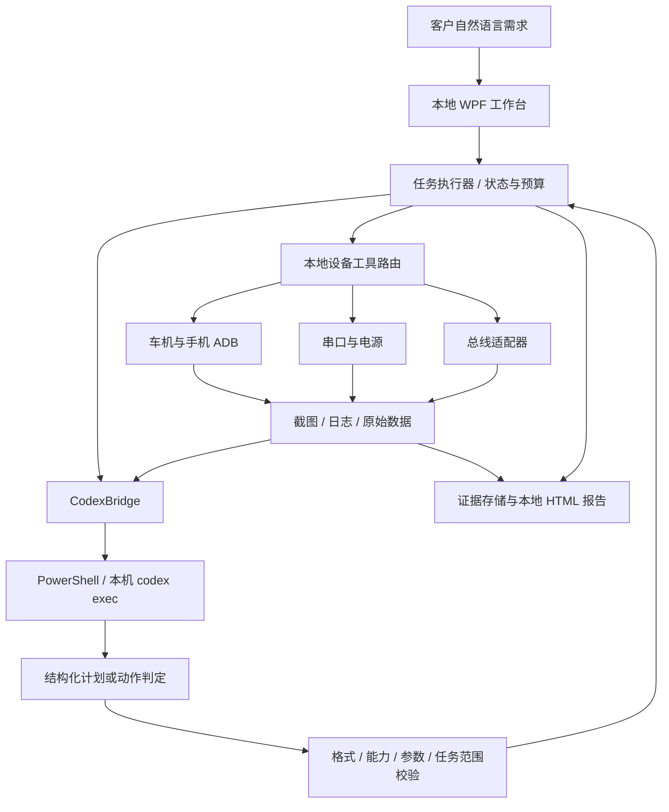
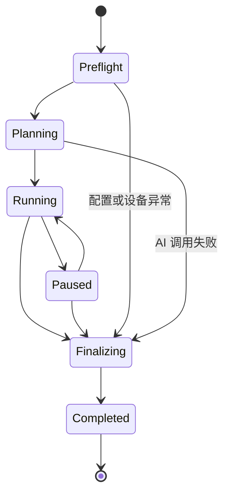

# AIclient：车机与手机 AI 自动化联调测试设计

版本：v0.1 · 日期：2026-10-24 · 状态：初版设计与本地版本实施依据

## 1. 目标与已经确定的边界

客户在 AIclient 输入“帮我测试下车机蓝牙功能是否正常”，客户端调用本机 Codex，将自然语言转换为可检查的测试目标；执行期间不断采集车机和手机截图，让 Codex 判断当前状态和下一步动作，再由客户端调用已经绑定的设备 API。结束后保存逐步截图、设备收发、总线数据及 AI 判定，生成可在浏览器查看的 HTML 报告。

用户已明确：

- 所有新增项目和文档位于本目录 `AIclient`。
- 参考现有 AT 客户端；实际仓库名称为 `AT_Web_Client`，没有名为 `ATclient` 的根目录项目。
- 首版在 Windows 本地运行，无需连接现有 Web 平台、账号中心、任务服务器或报告上传服务。
- Codex 优先通过 PowerShell 调用本机 CLI，沿用本机已有登录。自然语言拆解和截图判断走同一接入层，不要求另配 OpenAI API Key。
- 常规流程默认自动继续，计划生成后自动进入执行；支持查看计划、暂停和停止。配置不全时报告具体原因，不能将缺失的设备或测试结果补成成功。
- 最终报告仍然是可浏览器预览的本地 HTML；“暂不与 Web 交互”不影响这一要求。

这是一套“AI 规划和观察 + 本地确定性设备执行 + 可追溯证据”的测试系统。一次自然语言任务必须落到明确的测试范围、真实设备、具体操作和可以复核的判定上。

## 2. 使用流程

1. 工程师建立本地台架，绑定车机、手机、串口、车辆总线和电源。
2. 验证设备在线，配置蓝牙名称、配对策略、允许的设备命令、DBC 和预期信号等项目资料。
3. 客户输入自然语言需求，可选择已保存的测试模板。
4. 客户端将需求、实际可用能力、台架资料和测试规则送给 Codex。
5. Codex 返回结构化计划，写入本地文件并显示；客户端验证后自动执行。
6. 对每个测试目标：截图与日志取证 → Codex 分析 → 校验动作 → 本地执行 → 再次截图与采集 → Codex 验证，直至明确结论或达到边界。
7. 任务结束或中断后，停止本任务的监控，保存所有结果并生成本地 HTML 报告。

例：客户说“测试蓝牙”，系统应显示此次覆盖的是开关、发现、配对、连接、断开和重连等项目。未配置通话对端、音频采集或相应验证能力时，将 HFP 通话、A2DP 实际声音等列为未覆盖，不能宣称“蓝牙全部正常”。

## 3. 现有 AT 项目的参考与复用

| 现有位置 | 已看到的能力 | AIclient 的处理方式 |
| --- | --- | --- |
| `AT_Web_Client/Workbench/MainWorkbench.xaml` | WPF + WPF-UI，设备配置、执行和日志导航 | 延续 Windows 桌面工作台模式，增加自然语言任务入口 |
| `AT_Web_Client.Kernel/Services/AddinServices/IADBService.cs` | 多 ADB 设备、点击、滑动、Shell、Logcat | 以角色绑定和强类型工具替代默认主设备路由 |
| `AT_Web_Client.Kernel/Base_Function/ADB/IADB_Device.cs` | 设备身份、连接、截图 | 每次保存独立截图文件及采集时间，避免复用可变缓存图 |
| `Addins/Addin.AdditionalDevice`、`ISerialService.cs` | 串口收发、监控、继电器 | 新增独立串口适配器，保留原始字节和解码文本 |
| `Addins/Addin.VehicleBus`、`ICANService.cs` | CAN/CAN FD/LIN/FlexRay、DBC、信号检查 | 定义独立总线契约，按实际硬件逐个接入 |
| `Addins/Addin.PowerModule`、`IPowerService.cs` | 输出、电压、电流测量 | 配置命令与边界，统一为电源工具 |
| `Addins/Addin.Report/ReportService.cs` | JSON 报告、步骤、图片和 CAN evidence | 参考数据层次，新增离线 HTML 和 evidence 清单 |
| `Addins/Addin.ExecutionCore` | 项目和任务执行、报告生命周期 | 新增支持取消和逐步观察的执行器 |

现有工程主要使用 .NET Framework 4.7.2，设备服务常依赖 `IWPFUI`、全局服务容器和第三方 DLL。不能假定 DLL 可直接加载到新运行时。首版独立实现 ADB、串口和标准串口协议；专有 SDK 后续通过匹配位数和运行时的独立 Host 适配，避免将旧界面和服务器依赖整体带入。

## 4. 总体架构



职责划分：

- Codex：理解需求、生成测试目标、识别截图、提出动作、依据证据判定。
- 执行器：确定何时执行、操作哪个设备、是否允许该动作、何时停止、如何保存结果。
- 设备适配器：完成一次真实设备操作并返回实际结果。
- 报告层：从已记录的数据生成报告，不能通过 AI 生成一份替代真实执行的数据。

首版不让 Codex 自行运行 ADB、任意 PowerShell 或修改台架配置。Codex 返回工具请求，由 AIclient 分发。这可以保证截图、串口数据和实际动作全部经过同一条可记录的执行路径。

## 5. 本地 Codex 接入

### 5.1 选择与核对依据

采用 `AIclient → PowerShell → 本机 codex exec → JSON 结果`。本机已发现 `C:\Users\AT\AppData\Roaming\npm\codex.ps1`；2026-10-24 实测版本为 `codex-cli 0.163.0`，`codex exec --help` 显示支持：

- `exec` 非交互执行，`-` 从 stdin 读取提示词。
- `--image` 传入截图。
- `--output-schema` 约束最终结果结构。
- `--output-last-message` 将最终回答独立写入文件。
- `--json` 输出事件流，`--cd` 指定工作目录。

官方文档入口：<https://developers.openai.com/codex/cli/>。本次访问官方网页受限，因此上述参数以本机 CLI 帮助为核对依据。CLI 版本升级后需要重复能力检查。

登录与额度：沿用用户现有 CLI 登录和模型配置，不读取或展示凭据，不另建 API Key 接入。当前对话与本地 CLI 是否共享同一额度池由实际登录账号和权益决定，不能从“都叫 Codex”推断。CLI 安装在本机不代表推理离线；网络、模型访问和额度仍需可用。

### 5.2 每次调用的文件与生命周期

```text
runs/<runId>/ai/<requestId>/
  request.json       输入上下文、目标、截图引用、允许工具
  prompt.txt         本次发送的完整提示词
  response.schema.json
  stdout.jsonl       CLI 标准输出事件
  stderr.txt         诊断信息
  response.json      CLI 最终结果
  invocation.json    开始结束时间、CLI 版本、退出码、耗时
```

每次使用独立请求目录，禁止覆盖其他轮次输出。用 `ProcessStartInfo.ArgumentList` 启动 PowerShell 的固定脚本；提示词通过 stdin 传递，图片路径和选项采用数组参数。自然语言、串口返回、设备名称和模型输出都不能拼接为可执行脚本；不得使用 `Invoke-Expression`。

推荐参数形态如下，仅为调用约定，实际由 Bridge 生成参数数组：

```text
codex exec --cd <run-directory> --sandbox read-only
  --skip-git-repo-check --color never --json
  --output-schema <schema-path>
  --output-last-message <response-path>
  --image <adb1.png> --image <adb2.png> -
```

Bridge 继承已有登录环境，不将 `CODEX_HOME` 指向任务目录，不复制用户认证文件。退出码、JSON 解析和字段校验全部成功后才接受响应；stdout 中的工具事件或一段说明文字不是设备动作。

### 5.3 上下文、超时与异常

- 首版每次明确发送计划、当前目标、近期实际动作、截图和日志摘要，避免依赖用户其他 CLI 会话；不使用 `resume --last`。
- 后续可以使用显式 session ID 优化上下文，但必须按任务隔离并处理 CLI 版本差异。
- 默认每次 AI 调用超时 180 秒；任务限制总用时、每目标动作数和 AI 调用数，均可配置。
- 无输出、超时、登录过期、额度不足或模型不支持图像，显示明确诊断并保存中断报告。
- AI 请求可在无设备动作发生时有限重试；设备点击、串口发送、总线注入、电源动作不能因 CLI 重试而重复执行。
- 客户点击停止后取消当前调用及其子进程，禁止迟到结果触发下一步动作。后台设备采集在收尾阶段关闭并刷新到磁盘。
- CLI 自身的批准策略由本机配置和安装版本决定。AIclient 的自动执行设置不能绕过操作系统或宿主强制审批。

## 6. 台架、设备与工具契约

### 6.1 设备身份

ADB 按中性编号 `adb1` / `adb2` 绑定稳定 serial，不强制设备类型；可以只绑定一个，也可以两台都是手机、两台都是车机或其他 Android 组合。一般将 ADB1 理解为车机、ADB2 理解为手机仅是弱默认约定，实际需求、项目背景和截图优先。不得仅因 ADB1 是手机阻止可执行的测试。禁止在设备断线后自动选择扫描列表中的另一个设备。截图必须包含编号（role）、serial、分辨率、采集时间和 evidenceId。

初版支持 Android ADB。iPhone 不能按 Android ADB 处理，后续需要单独适配器。车机禁用 ADB 或截图黑屏时，需外部采集卡/相机和可控输入能力，不应声称现有链路可以覆盖。

### 6.2 配置项

| 类型 | 配置内容 | 连接与自检 |
| --- | --- | --- |
| ADB | adb.exe、role → serial、蓝牙名称、设备说明 | 扫描、绑定、在线检查、截图、设备尺寸 |
| 串口 | COM、波特率、数据位、停止位、校验、编码、换行 | 打开、接收计数、最后接收时间、手动发送 |
| 总线 | 适配器类型、通道、速率、DBC、关注信号 | 连接状态、帧数、解析状态、原始帧监控 |
| 电源 | 传输、串口配置、输出/关断/设压/查询命令、允许电压 | 连接、设备标识或应答、输出状态 |
| 项目资料 | 蓝牙名称、配对前提、测试步骤模板、命令别名、信号规则 | 执行前完整性检查 |

首版原生支持标准串口与串口电源；总线先提供 SLCAN 兼容 CAN 接入和标准日志分析。SLCAN 不是通用厂商 SDK，不能代替 CAN FD/LIN/FlexRay。专有总线硬件在完成对应适配器前明确显示不支持。DBC 第一阶段支持基本标量信号，复用、多路复用、浮点或复杂诊断等必须识别并报告限制。

### 6.3 工具

| 工具 | 参数示意 | 真实结果与证据 |
| --- | --- | --- |
| `adb.capture` | role | PNG、尺寸、serial、时间 |
| `adb.tap` | role, x, y | 退出码、点击位置、前后截图 |
| `adb.swipe` | role, x1, y1, x2, y2, durationMs | 执行日志、前后截图 |
| `adb.key` | role, key | 受支持按键的执行结果 |
| `adb.text` | role, text | 实际输入结果，记录敏感信息处理方式 |
| `serial.send` | commandAlias | 配置中已定义的原始发送内容与应答 |
| `serial.expect` | channel, pattern, timeoutMs | 时间窗口、命中的原始日志 |
| `bus.send` | commandAlias | 实际通道、CAN ID、数据和返回值 |
| `bus.expect` | signal, expected, tolerance, timeoutMs | 原始帧、DBC 版本和解析值 |
| `power.output` | on | 实际命令及设备应答或未知状态 |
| `power.voltage` | volts | 配置范围校验、实际命令和可用时的测量值 |
| `wait` | durationMs | 明确等待时间，后台仍持续采集 |

工具操作成功与功能断言通过分别记录。ADB 返回 0 只说明命令执行成功；必须用新截图或设备数据验证功能效果。电源命令成功发出也不能在没有回读时声称输出已经实测生效。

设备命令别名由工程师预先配置，模型只能引用已有别名；例如 `wake_adb1`、`vehicle_parked`。总线数值、DBC 信号名、串口关键字不能让模型虚构。

## 7. 计划与动态执行

### 7.1 计划是验收目标，不是固定坐标脚本

计划包含任务标题、范围、前置条件、未覆盖内容和若干测试目标。每个目标包含操作意图、预期、设备角色、所需能力以及步骤预算。实际点击坐标要根据执行时截图实时确定。

```json
{
  "title": "车机与手机蓝牙基础联调",
  "scope": "开关、发现、配对、连接、断开、重连",
  "uncovered": ["未配置音频采集，不能证明 A2DP 实际音质正常"],
  "steps": [
    {
      "id": "S01",
      "title": "进入双方蓝牙设置并开启蓝牙",
      "expected": "车机和手机均显示蓝牙开启，界面可正常交互"
    },
    {
      "id": "S02",
      "title": "发现目标并完成双方配对",
      "expected": "设备名称匹配、双方配对请求一致，最终显示已连接"
    }
  ]
}
```

JSON 为领域结构示意；实施时固定版本 Schema，校验长度、步骤数、必填字段和工具参数。

### 7.2 单次决策

每次向 Codex 提供：原始需求、计划快照、当前步骤预期、真实设备角色、允许工具、最近动作及结果、带 evidenceId 的新截图、相关时间窗口的串口/总线摘要。

Codex 返回 `action`、`pass`、`fail` 或 `inconclusive`。`action` 每次仅包含一个本地工具请求；结论包含可复核的说明和输入中存在的 evidenceId。客户端验证 evidenceId、参数和设备绑定；低质量图片、证据冲突或缺失时补采集或输出无法判定。

日志和截图中的文字属于被测数据，不能改变系统规则或授权新工具。只保存可供用户复核的观察、操作理由和结论，不要求或保存模型内部思维链。

### 7.3 执行状态



- 暂停：不发新动作；正在执行的原子动作完成后暂停，监控继续。
- 停止：取消后续动作与 AI 调用；执行可取消操作的取消，再保存报告。
- 断线：标记设备错误，不把旧截图交给 AI 当作当前状态。
- 重试：先重新观察，确认前一次操作是否已生效，避免二次点击反转开关。
- 进程崩溃恢复：读取已落盘记录，标记上次任务中断，重建报告；首版不自动恢复硬件动作。

每个物理设备同一时刻只允许一个执行任务持有；日志订阅可以复用，但发送和电源动作必须统一调度。

## 8. 蓝牙完整示例与判定边界

| 阶段 | 客户端动作 | Codex 判断与所需证据 |
| --- | --- | --- |
| 环境 | 校验双方在线，记录系统版本、蓝牙名称与当前截图；启动串口/总线采集 | 设备身份明确；原始配对状态可见 |
| 开关 | 根据截图进入蓝牙页、开启蓝牙 | 开关状态变化，双方界面保持可操作 |
| 发现 | 在双方允许的发现模式下扫描 | 找到配置中的目标名称；同名设备时不能随意猜选 |
| 配对 | 点击目标，读取双方配对界面，按当前项目策略确认 | 配对码或请求相符，双方确认后的新截图 |
| 连接 | 观察双方设备详情 | 双方连接状态一致；可用时结合 profile/logcat/串口信息 |
| 断开 | 通过界面断开并等待状态变化 | 双方实际断开，不仅仅是触发了点击 |
| 重连 | 手动连接或按明确要求重启/切换蓝牙后观察 | 在预设时间内恢复连接，超时记录实际耗时与状态 |
| 可选媒体 | 配置测试音源、播放操作和采集手段 | A2DP 已连接与实际播放分别验证；无采集时音频结论不通过推测产生 |
| 可选通话 | 配置测试号码、对端和音频采集 | HFP 状态、呼叫建立、双向音频分别验证 |
| 收尾 | 停止本任务监控，保存最终状态和所有文件 | 明确已测/未测、失败位置、恢复状态与报告路径 |

“蓝牙正常”的任务总评必须附带范围。例如“基础连接流程通过；通话与实际媒体声音未验证”。不能把“配对成功”扩展成“全部蓝牙能力通过”。

## 9. Evidence 与报告

### 9.1 落盘结构

```text
data/
  settings.json
  runs/<runId>/
    run.json                   任务、范围、配置快照、当前状态
    plan.json                  本次实际采用的计划
    events.jsonl               追加写的动作与状态事件
    evidence.json              所有证据索引
    screenshots/               每轮双方原始 PNG
    logs/serial.jsonl          时间戳、通道、方向、原始字节和文本
    logs/bus.jsonl             时间戳、通道、CAN ID、DLC、原始数据
    ai/<requestId>/            每轮 Codex 输入输出与错误
    report.html                自包含摘要和相对图片引用
```

时间使用 UTC ISO 8601，界面转换为本地时间。耗时使用单调计时器；总线硬件时间另存其来源和基准，不直接与 PC 时钟混用。

证据索引包含 evidenceId、runId、stepId、attempt、设备身份、采集起止时间、相对路径、类型、SHA-256。原始图片不覆盖；标注、裁切或压缩图作为派生证据关联原图。连续监控日志按时间窗和记录序号关联多个步骤，保留步骤前后窗口以解释状态变化。

截图先写入文件并关闭，再交给 Codex。动作意图先记入事件日志，操作返回后补充结果；即使中途异常，也能知道最后一个已发出的动作。重要检查点持久化；证据落盘失败会停止依赖该证据的后续判定。

### 9.2 结果与汇总

步骤结果：`Passed`、`Failed`、`Inconclusive`、`Error`、`Skipped`、`Cancelled`。运行状态与业务结论分别保存：一次正常结束的运行可以包含功能失败；工具异常不能直接认定被测功能失败。

总评规则：必测项失败则 Failed；基础设施错误单列 Error；缺少必测证据或未执行则不能汇总 Passed；取消则 Cancelled。非覆盖项目与选测项单列，不计作通过。已完成的证据和失败保留，重试后不能抹掉第一次失败记录。

### 9.3 本地 HTML 报告

报告显示需求原文、范围、设备与版本、起止时间、结果统计、每步预期/实际、实际操作时间线、截图、日志/总线片段、AI 观察、错误、未覆盖项目和证据文件链接。图片支持浏览器查看原图。

首版静态 HTML 直接嵌入结构化摘要，图片和原始日志使用相对路径，不通过 `fetch()` 读取本地 JSON，避免 `file://` 跨域问题。所有来自需求、设备与模型的文本 HTML 转义。无需 CDN、外部服务器或第三方在线脚本；复制整个运行目录后仍可预览。可后续增加 ZIP 打包和已有 Web 平台上传。

## 10. 本地界面

- **测试工作台**：台架状态、自然语言输入、生成计划并运行、暂停/继续、停止、步骤状态、运行日志。
- **实时观察**：ADB1 与 ADB2 最近截图、编号/serial、截图时间、当前 AI 观察和正在执行的动作；不将设备编号固定显示为车机或手机。
- **设备配置**：ADB 扫描绑定、串口、总线、电源、命令别名、项目上下文。
- **运行记录**：本地历史列表、结果、目录和 HTML 报告入口。
- **设置**：Codex/PowerShell/ADB 路径、模型可选覆盖、超时与预算、输出目录、自动执行。

界面以任务和证据为中心。面向客户的状态显示“正在查看车机蓝牙界面”“正在验证双方连接状态”等业务描述；CLI 参数和原始错误放在可查看的诊断日志。

## 11. 技术与目录建议

本机已有 .NET SDK 9.0.312 与 WindowsDesktop 9.0.14。首版使用 `net9.0-windows` WPF，避免新增前端服务；后续迁移到团队选定的受支持运行时。尽量不引入需要下载的依赖，设备 SDK 按硬件单独添加。

```text
AIclient/
  DESIGN.md
  README.md
  AIclient.sln
  src/AIclient/                  WPF 应用
    Models/                      配置、计划、动作、结果和 evidence
    Services/                    Codex、执行器、设备、存储与报告
    Views/                       工作台和配置
  scripts/                       固定 PowerShell Bridge 与启动脚本
  tests/                         脱离真实硬件的流程与契约验证
```

首版模块通过接口和结构化 DTO 分离，不要求一开始拆成很多程序集。运行数据留在 `AIclient/data` 并排除版本控制。

## 12. 实施顺序与验收

| 阶段 | 实际交付 | 验收依据 |
| --- | --- | --- |
| A：本地骨架 | 工作台、配置持久化、设备角色、历史和模拟模式 | 无硬件时能运行明确标注为模拟的任务，输出报告 |
| B：Codex + ADB 闭环 | CLI Bridge、JSON 计划、双设备截图、动态动作与验证 | 真实 CLI 图像请求和真实 ADB 操作可逐次复核 |
| C：监控与设备动作 | 串口持续采集、配置命令、标准电源、首个总线适配器 | 原始收发与步骤时间线一致，重试不重复副作用 |
| D：证据和报告完善 | 哈希索引、终止与异常报告、离线预览 | 失败/取消也有报告，复制目录后图片和链接有效 |
| E：专有能力 | 指定厂商 SDK、CAN FD/LIN/FlexRay、媒体/通话采集 | 用真实台架及约定用例验证，不能用模拟结果代替 |

关键验收场景：

1. 需求生成的计划可解析，步骤有明确预期，超出能力的范围被列出。
2. 两台 ADB 设备分别绑定，所有动作和截图对应正确 serial。
3. Codex 根据本轮截图给出动作，客户端执行后提供新截图验证。
4. 断线、黑屏、非法坐标、未知命令、无效 JSON、CLI 超时均停止错误操作并留证。
5. 连续串口/总线采集不被 AI 等待阻塞，数据可以追溯到步骤窗口。
6. 暂停不发新动作，停止后无迟到动作，失败重试保留原始记录。
7. HTML 报告可直接本地预览，文本注入被转义，证据路径与哈希可核对。
8. 没有真实硬件或登录测试时，交付说明明确区分已验证的软件行为与待实机验证内容。

## 13. 首版默认决策与实际限制

- 使用本机 PowerShell + Codex CLI；优先继承现有登录与模型设置。
- 生成计划后自动执行；不在每次点击、截图或分析时额外要求客户确认。
- 首版单任务运行，两个中性 Android ADB 编号，支持双手机等组合；设备可只配置其中一端，双端测试时缺失能力会明确列出。
- 配对清除、重置、电源循环等只在任务范围与已配置操作中执行；遇到不能自动化的被测设备物理操作时给出阻塞原因。
- 不预设串口关键字、DBC 信号或电源厂商命令；来自真实项目资料与配置。
- 软件可在无硬件下完成构建和模拟流程验证；真实蓝牙、专有总线和电源效果需接入台架验证。
- 初版无需 Web 后端；报告与证据先本地完整保留，后续可以增加平台同步而不更换执行模型。
